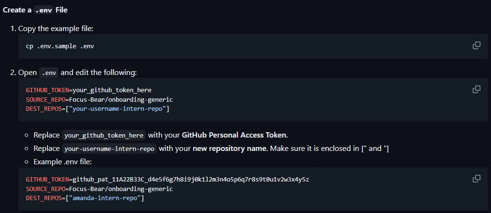
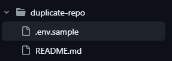
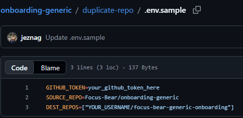

# Paul Dal Pozzo

**Student ID:** s214527809  
**Email:** s214527809@deakin.edu.au  
**Intern Position:** Usability Tester & Bug Hunter  
**Focus Bear Account:** paul_dal_pozzo@hotmail.com  
**Markdown Location:** https://github.com/pdalpozzo/paul-dalpozzo-focusbear-intern-repo/blob/main/IssueWork/ENV_setup_confusion.md

# Issue 16
## Understanding the Issue
>**Description:**  
>
>While working on the repository duplication step, I faced multiple errors related to the .env file configuration. The script was throwing an error saying "undefined is not valid JSON", which made it difficult to understand what exactly was going wrong at first.

This issue is feedback about the repository duplication step. The user is claiming to have multiple errors related to the `.env` file. The error they received was `undefined is not a valid JSON`.
I agree. That error message is not doing a good job of describing the issue. What is `undefined` in this case?

>**What I noticed**
>- The script is expecting DEST_REPOS, but in some places it is mentioned as DEST_REPO
>- The value for DEST_REPOS needs to be in a JSON array format like ["username/repo"], but this was not clearly explained
>- Even small mistakes in the .env file (like extra characters or wrong format) caused the script to fail without clear guidance

Here we have more details. The user mentions `DEST_REPOS` and `DEST_REPO`. Both are variables that provide a destination (in this case) for a repository to be duplicated to.
- `DEST_REPO` is singular. It expects a plain text string that represents a URI of a repository. Eg `DEST_REPO=<username>/<repository>`. No other syntax is needed.
- `DEST_REPOS` is plural. It expects a JSON format array (one or more URI). Eg `DEST_REPOS=["<username1>/<repository1>", "<username2>/<repository2>"]`. The syntax of the JSON array is needed, even if there is only one entry.

I checked the `duplicate-repo.js`, `.env.sample` and `README.md`; they only contain `DEST_REPOS`. I am not sure where the user was seeing `DEST_REPO`.

>**Suggestions:**
>
>It would be helpful if:
>- The correct variable name is clearly mentioned everywhere
>- A proper example of the .env file is provided
>- The expected format for DEST_REPOS is explained more clearly

README.md screenshot
  

**1. The correct variable name is clearly mentioned everywhere**  
Above is a screenshot of the `README.md`. `DEST_REPOS` is the only one ever mentioned.

**2. A proper example of the .env file is provided**  
There is a sample provided in the `.env.sample` file. Here are two screenshots from the GitHub Repository.

  
This clearly shows the `.env.sample` file.

  
This clearly shows the contents of the sample file. While it does not match the instructions in the `README.md` word for word, it seems clear to me that `DEST_REPOS=["your-username-intern-repo"]` and `DEST_REPOS=["YOUR_USERNAME/focus-bear-generic-onboarding"]` are in the same location and are the same variable. You can also see that the example is already in the format that is expected.

**3. The expected format for DEST_REPOS is explained more clearly**  
In the above screenshot of the `README.md`, the `DEST_REPOS` formatting is clearly explained and visible. The exact line is
>Replace `your-username-intern-repo` with your **new repository name**. Make sure it is enclosed in [" and "]  

Only way it could be more clear is to highlight the syntax in the same way the repository name. Eg `["` and `"]` then give the full example of `["your-username-intern-repo"]`
