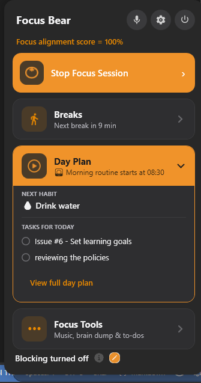

# Paul Dal Pozzo

**Student ID:** s214527809  
**Email:** s214527809@deakin.edu.au  
**Intern Position:** Usability Tester & Bug Hunter  
**Focus Bear Account:** paul_dal_pozzo@hotmail.com  
**Markdown Location:** https://github.com/pdalpozzo/paul-dalpozzo-focusbear-intern-repo/blob/main/IssueWork/learning_goals.md

# Issue 6
## Reflection
**What do you hope to learn from this internship?**  
I want to learn how to properly analyze and test the application. I have done stuff like this before on personal projects but they were never as large as this app. I also want to learn how to even organize a team of such a size. Not that I want to start my company, but I like to understand the structure and chain of command in the company. It allows me to enhance my skills and become more independent and become more helpful to others. 

**What skills are you most excited to develop?**  
Like I mentioned above; my skills in testing and analyzing. I think these skills are so severely underrated these days and yet they are the most important skills to have; especially in this age of AI.  
I also see this as an opportunity to practice my code reading and understanding skills. Entering a large code base with no contribution or any real understanding of the intention behind things will be a very common thing in the industry.

**What do you think you can contribute to the team?**  
I know that my position is Usability Tester & Bug Hunter, but I want to help the applications flow and hopefully that helps its retention issues. I also want to make sure there is a lot of consistency and the app works the way the user expects.
One example is the shortcut on the taskbar. I click it and expect the app window to appear, but instead the timer in the corner expands. Where do I click to bring up the window? I have to click 'View full day plan' to bring up the window and work from there. 

But even the corner overlay, I click it and nothing happens. Shouldn't it bring up the pop up in the image above? I clicked the overlay and nothing happened. No feedback to the user.

**What is one area you feel less confident in that you’d like to improve?**  
I don't think I will be able to improve on anything I am not confident in. But, I think I will improve in my communication abilities. I think they need work. It's not a confidence things, its a 'consider others' feelings' thing. I am usually very blunt and direct. I do not like to sugar coat things, but at the same time, the way I deliver my feedback can seem cold.

**What does success in this internship look like for you?**  
All I really care about is passing the unit to graduate. A pass grade will be a success for me. But, I don't think I will stop if I reach that goal early. I intend to make the full 6 weeks count. I am treating this placement as a job, working almost full days (unless family things pop up). I need to get used to sitting at the computer for a full workday and be able to control my breaks and focus.

